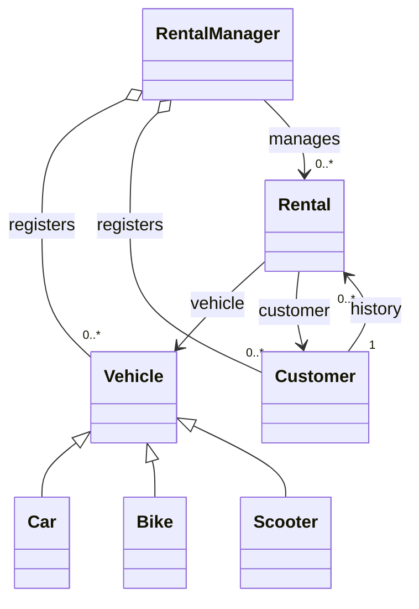

# Vehicle Rental Management System — OOP Assignment 3

**Student:** Gerald Musiyazwiriyo  
**Student ID:** 59228  
**University:** WSB University (Akademia WSB)  
**Programme:** BSc Computer Science — Mobile & Cloud Computing  
**Technology:** C# / .NET 9 console application

## 1. Application topic

This project models a small vehicle rental service. The service registers cars, bicycles and electric scooters, registers customers, rents an available vehicle for a specified number of days, calculates the rental fee according to vehicle type, tracks customer rental history, and processes returns. It demonstrates an object-oriented domain model rather than a full production booking website.

## 2. Classes, responsibilities, properties and methods

| Class | Responsibility | Key properties | Key methods |
| --- | --- | --- | --- |
| `Vehicle` (abstract) | Define shared vehicle identity, availability and rental contract | `Id`, `Brand`, `Model`, `DailyRate`, `IsAvailable`, `VehicleType` | `Rent()`, `ReturnVehicle()`, `CalculateRentalFee(days)` (abstract) |
| `Car : Vehicle` | Model a car and its rental-price policy | `Seats` | `CalculateRentalFee(days)` |
| `Bike : Vehicle` | Model a bicycle and its long-booking discount | `HasElectricAssist` | `CalculateRentalFee(days)` |
| `Scooter : Vehicle` | Model a scooter and its safety-kit fee | `BatteryRangeKm` | `CalculateRentalFee(days)` |
| `Customer` | Store customer identity and rental history | `Id`, `FullName`, `Email`, `RentalHistory` | `RecordRental(rental)` (internal) |
| `Rental` | Represent the link between a customer and a vehicle for a booking | `Id`, `Customer`, `Vehicle`, `Days`, `StartDateUtc`, `ReturnedAtUtc`, `TotalFee`, `IsActive` | `Close(returnedAtUtc)` (internal) |
| `RentalManager` | Coordinate registration, rental, return and queries | `Vehicles`, `Customers`, `Rentals` | `RegisterVehicle()`, `RegisterCustomer()`, `RentVehicle()`, `ReturnVehicle()`, `GetAvailableVehicles()` |
| `Program` | Supply example objects, demo and self-tests | Local example objects | `RunSelfTests()` |

## 3. Relationships between classes

1. **Inheritance (is-a):** `Car`, `Bike` and `Scooter` derive from abstract `Vehicle`.
2. **Association (object property):** `Rental` references exactly one `Customer` and one `Vehicle` through constructor-injected, read-only properties.
3. **Aggregation (collection):** `RentalManager` holds collections of registered `Vehicle` and `Customer` objects that are created independently and supplied to it.
4. **Collection / history association:** `Customer` maintains an encapsulated list of related `Rental` objects, exposed as read-only.
5. **Method-parameter dependency:** `RegisterVehicle(Vehicle vehicle)` and `RegisterCustomer(Customer customer)` accept objects through method parameters.

Simplified class diagram:



## 4. Four OOP principles

- **Encapsulation:** `Vehicle.IsAvailable` has a private setter and is changed by guarded `Rent()` / `ReturnVehicle()` methods; customer history and manager collections are private and exposed using `IReadOnlyList`. Rental closure is controlled by an internal method.
- **Inheritance:** `Car`, `Bike` and `Scooter` inherit from `Vehicle`, sharing validated core properties and availability behaviour.
- **Polymorphism:** the demo loops over `Vehicle` references and calls `CalculateRentalFee(3)`. Runtime dispatch selects the `Car`, `Bike`, or `Scooter` implementation.
- **Abstraction:** the abstract `Vehicle` class defines the `CalculateRentalFee(int days)` contract and cannot be instantiated directly.

## 5. Additional design choices

- **Constructors:** require a valid brand, model, daily rate, customer name and email at creation time.
- **Unique identifiers:** each main entity (`Vehicle`, `Customer`, `Rental`) has a `Guid` identifier.
- **Single Responsibility Principle:** vehicle subclasses own pricing behaviour, `Rental` stores booking data, `Customer` stores customer data/history, and `RentalManager` coordinates service operations.
- **Validation:** nonpositive rental days, invalid customer data, duplicate registrations, double-booking, and double-return attempts are rejected with explicit exceptions.
- **Scope:** in-memory console exercise; no database, login, payment processing or persistence. The sample prices are illustrative, not actual rental offers.

### Illustrative pricing rules

| Type | Example daily rate | Rule | Three-day total |
| --- | ---: | --- | ---: |
| Car | 120 PLN | Days × daily rate + 20 PLN cleaning fee | 380 PLN |
| Bike | 30 PLN | Days × daily rate; 10% discount from seven days | 90 PLN |
| Scooter | 45 PLN | Days × daily rate + 5 PLN safety-kit fee | 140 PLN |

## 6. Run the application

Install the **.NET 9 SDK**, then open a terminal in the project folder:

```bash
dotnet restore
dotnet run
```

To run the built-in demonstration checks:

```bash
dotnet run -- --test
```

The self-test mode checks 14 scenarios covering subtype pricing, validation, registration, booking, double booking, return and history. A successful run ends with `All 14 self-tests passed.` Do not interpret that text as a result until you have executed the command on your own computer.

## 7. Expected demonstration behaviour

The program lists three vehicles using the same `Vehicle` type, displays their calculated three-day fees, books the car for Anna Kowalska, rejects an attempt to rent the occupied car again, returns the car and shows an updated rental history count. Rental IDs are randomly generated at runtime; their exact values will differ.

## 8. AI-use disclosure

AI assistance was used to help plan the domain model, structure classes and relationships, draft and review C# code, explain OOP concepts, and prepare this README. The student should examine the implementation, execute the demo and self-tests, and be prepared to explain the design before submission.


